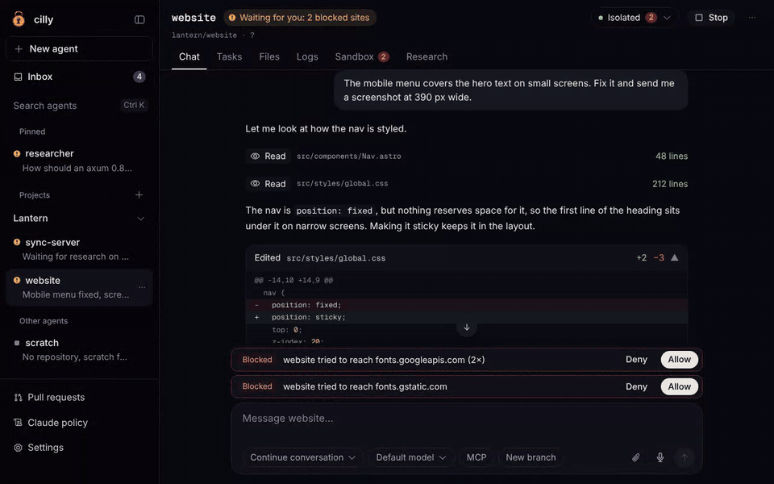
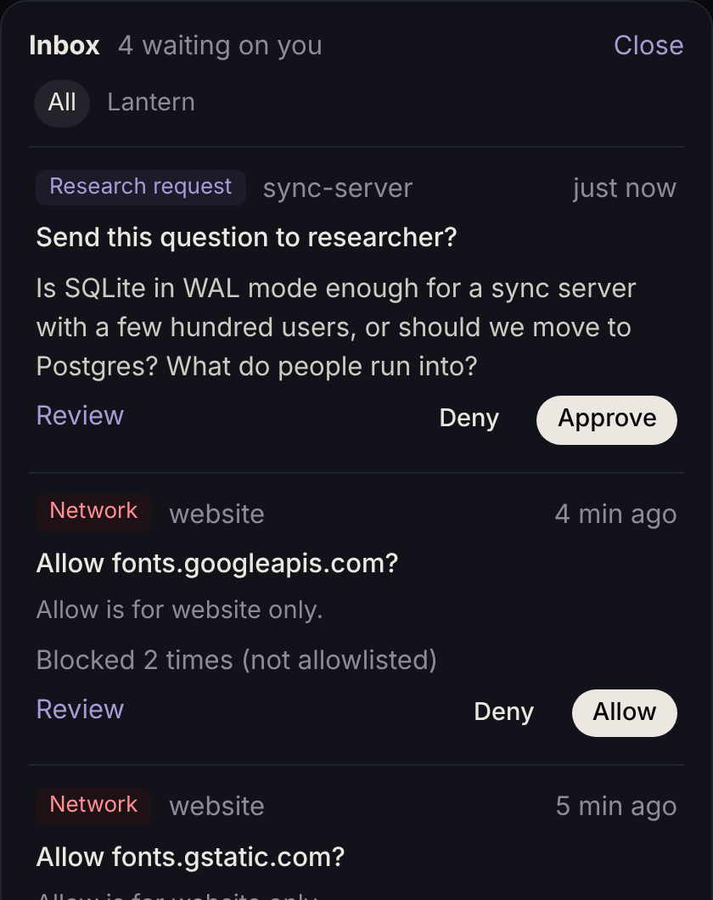
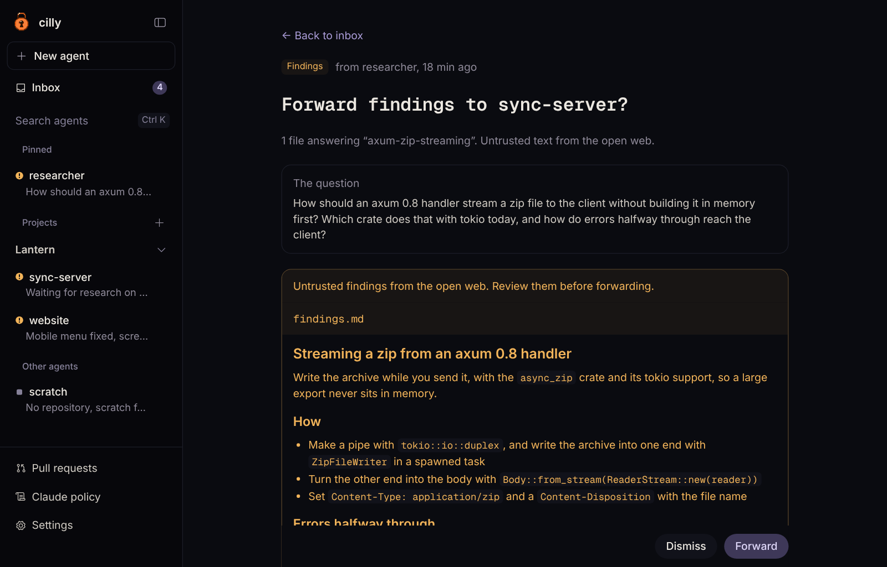
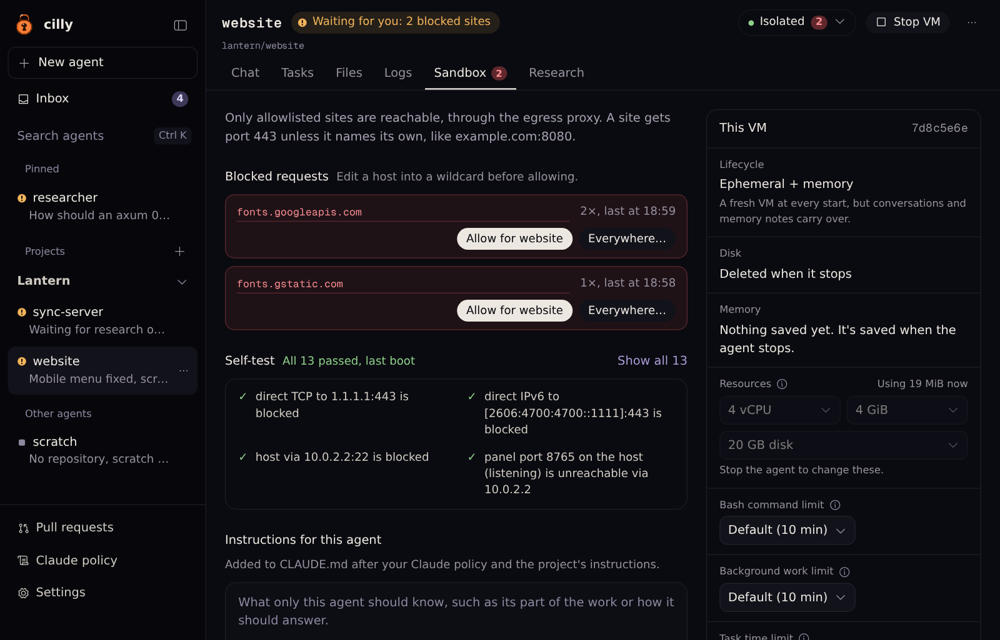
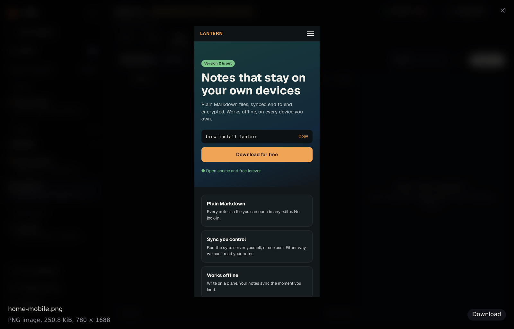
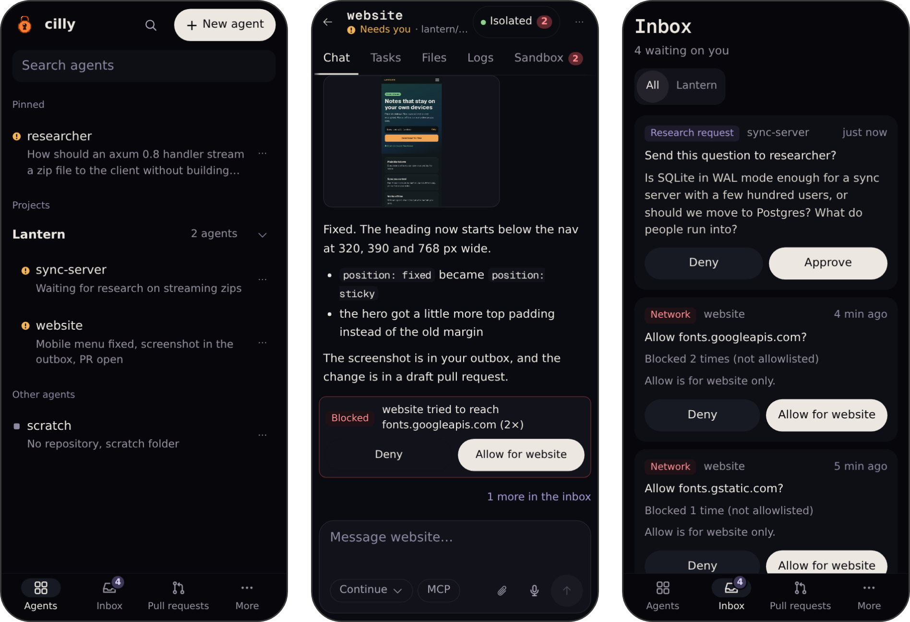
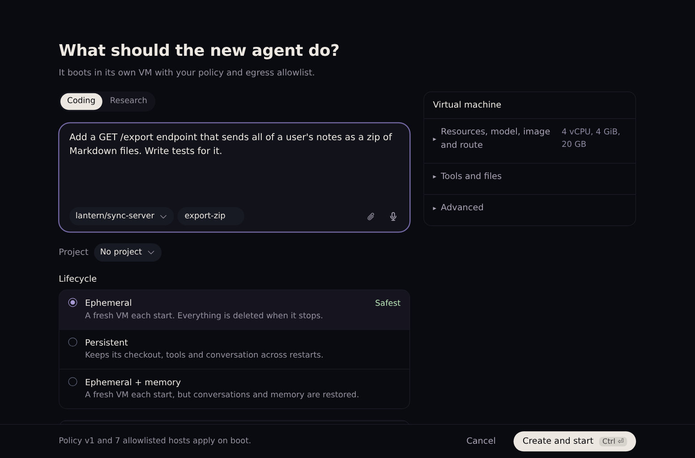
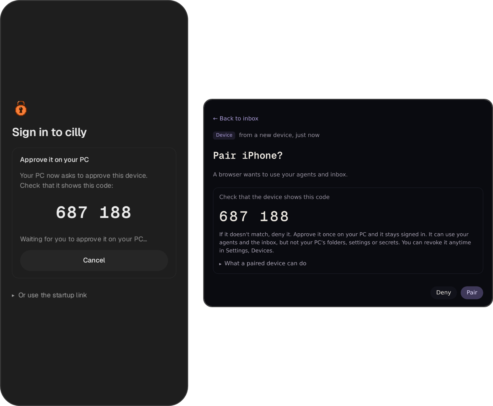

#  cilly

Claude Code agents in their own virtual machines, on your own Linux PC, started as your normal user. Give an agent a task in a chat. It works in a QEMU/KVM virtual machine that only reaches the sites you allowed, pushes to its own branch and opens a draft pull request.

**[Website and docs](https://cillybox.github.io) · [Guide](docs/guide.md) · [Quick start](#quick-start) · [Security model](#security-model) · [Status](#status)**

[](https://github.com/cillybox/cilly/actions/workflows/test.yml)   

<p align="center"></p>

## Why cilly

<table>
<tr>
<td width="33%" valign="top"><b>Each agent gets its own VM</b><br>A KVM guest with a throwaway disk. Nothing from your home folder is mounted.</td>
<td width="33%" valign="top"><b>Only the sites you allow</b><br>Every request goes through an allowlist on your PC. Blocked sites wait in your inbox.</td>
<td width="33%" valign="top"><b>Your tokens stay on your PC</b><br>The VM only gets stand-ins. The real tokens go in on the way out.</td>
</tr>
<tr>
<td valign="top"><b>No root in normal use</b><br>No Docker, no daemon, no <code>sudo</code>. Just QEMU and Python's standard library.</td>
<td valign="top"><b>Follow along from your phone</b><br>Pair a phone, read the chat, answer the inbox and send the next task.</td>
<td valign="top"><b>Claude or your own models</b><br>Use your Claude plan, or point an agent at a model server you run, on your network or on a rented GPU over SSH.</td>
</tr>
</table>

## Quick start

```sh
git clone https://github.com/cillybox/cilly ~/cilly && cd ~/cilly
less install.sh           # read it first, as it's the only step that runs as root
sudo sh install.sh        # once, for the packages and the kvm group
python3 -m cilly setup    # opens the panel and walks you through the rest
```

The setup in the panel builds a VM image, asks for your Claude login and the agents' GitHub token, and starts a first agent. [Full setup](#full-setup) has each step, and what the bot account needs.

<a name="security-model"></a>
<details open>
<summary><b>What it protects against</b></summary>

- **An agent damaging your PC.** It runs in a KVM guest, as an unprivileged user, on a throwaway disk. QEMU runs as you, inside bubblewrap.
- **An agent reaching hosts you didn't allow.** The only way out of the VM is an allowlist on your PC. Your local network and your own machines stay out of reach.
- **An agent reading your files or tokens.** Nothing from your home folder is mounted, and the VM only gets stand-ins for your tokens.
- **An agent pushing to `main`.** Its bot token only reaches the repositories you picked, and only its own branches.
- **A web page or a lost phone driving the panel.** It only listens on 127.0.0.1, needs a token on every request, and a paired phone can't reach your PC's folders, settings or secrets.

No sandbox removes every risk from an agent that holds a token and can reach the internet. [The full threat model](#threat-model) says what's left, and what limits it. To report a security problem, see [SECURITY.md](SECURITY.md).

</details>

<a name="threat-model"></a>
<details>
<summary><b>The full threat model</b></summary>

This is the short threat model. The design starts from the idea that an agent may be tricked by something it reads, so the VM, not the agent, has to be the safe part.

**It protects against:**

- **An agent damaging your PC.** It runs in a KVM guest, as an unprivileged user, on a throwaway disk overlay. QEMU runs as you, inside bubblewrap with no network and only that VM's files.
- **An agent reaching hosts you didn't allow.** The only way out of the VM is an allowlisting proxy on the host. It refuses other names, IP addresses, ports you didn't allow (443, plus what you add to `egress.ports` or name with a site, like `example.com:8080`), and names that lead to your LAN or to the panel itself.
- **An agent reaching your own machines.** The proxy refuses this PC's own addresses and anything inside a route other than the default route, so your local network (with its global IPv6 addresses), VPNs and bridges are out of reach, and so is anything you list in **Never reach**. The one exception is a model server you add under Local models: an agent set to one of its models reaches that one address, and only Anthropic's Messages API on it ([local models](docs/guide.md#local-models)). Over SSH, that address is cilly's tunnel on this PC's loopback, and nothing goes to it unless your account holds its port.
- **An agent reading your personal files or credentials.** Nothing from your home folder is mounted. The VM gets only stand-ins for the bot's scoped GitHub token and the agent's Claude login. cilly's proxy puts the real ones in on the way out, so they never enter the VM ([tokens](docs/guide.md#keeping-tokens-on-this-pc)).
- **An agent pushing to `main`.** The bot token only reaches the repositories you listed and can't change workflows or settings, cilly's proxy refuses git pushes outside the agent's own branches, and branch rules on GitHub block `main`.
- **An agent doing more on GitHub than its task.** With the bot's token, an agent reaches exactly these, and the proxy sends anything else to GitHub without a login:
  - git (clone, fetch and push) for its own repository, with pushes held to its own branches;
  - the REST API under `/repos/<its repository>`, where it can't change branches, tags, releases, rulesets or the repository itself;
  - GraphQL queries, which only read, never a mutation;
  - reading `/user` and `/rate_limit`.

  An agent without a repository gets no GitHub token at all. On github.com and api.github.com the proxy also drops every login and cookie that isn't the bot's. So a token an agent picked up from something it read can't push your code to someone else's repository or make a gist. All of this works through **Keep tokens on this PC**, which is on by default ([tokens](docs/guide.md#keeping-tokens-on-this-pc)).
- **An agent changing a folder you gave it.** Folders go in as a copy on a read-only disk, and symlinks that point outside the folder are left out.
- **An agent becoming root in its VM.** The image has no `sudo` and no setuid programs, and the program that runs tasks does everything in the agent's home as the agent user.
- **A web page driving the panel.** The panel listens only on 127.0.0.1 and needs a token on every request, with Host and Origin checks and a strict content security policy.
- **Sites learning your address, if you choose so.** A route sends agents' traffic through a SOCKS5 or HTTP proxy, a WireGuard VPN or Tor, with names looked up at the Tor exit, at the VPN's own DNS or over DNS-over-HTTPS through the route. It is a kill switch: when the route is down, agents reach nothing. An SSH tunnel to a model server can take a route too. Off by default ([routes](docs/guide.md#routes-a-proxy-a-vpn-or-tor)).
- **Your own SSH keys, when cilly opens a tunnel.** The tunnel to a model server uses a key made for that server only, which can forward to the model server's port and nothing else, and a host key you confirmed. ssh reads no config, key or agent of yours, and runs as you inside bubblewrap, without your home ([over SSH](docs/guide.md#over-ssh)).
- **A lost phone reaching your PC.** A paired device can't open your PC's folders, settings or secrets, only the files inside an agent's VM. The server refuses those calls, and you can remove the device at any time.

**What's left, and what limits it.** No sandbox removes every risk from an agent that holds a token and can reach the internet. These apply to any setup like this, whether the agent runs on your PC, in Docker or in the cloud. cilly narrows each one, and you can narrow them further.

| Risk | What limits it | What you can do |
|---|---|---|
| **The agent misuses the tokens it works with.** It can use the GitHub token and Claude login through cilly's proxy while it runs. | It holds only stand-ins, so it can't take the real tokens with it. The GitHub token goes only with its own repository and GraphQL queries, pushes go only to its own branches, and your branch ruleset keeps it out of `main`. A remote MCP server's key stays on this PC too, when it goes in a login header. A key that an MCP server running inside the VM needs reaches the VM, only while a task runs. | Give tokens a short expiry. Use an API key with a spend limit for research agents. |
| **The agent sends data to a host you allowed.** For example, your code to a package registry, with a login it found in something it read. | Only hosts you allowed are reachable, and coding agents can never get the open web. On GitHub it can only be the bot, or nobody. Elsewhere, such as `registry.npmjs.org`, the proxy can't tell an upload from a download. | Keep the allowlist short and secrets out of your repositories. |
| **A research agent reaches your own machines.** It has the open web, and a name it controls can point at any address. | It gets public sites on port 443 only, or on 80 too if you add 80 to `egress.ports`, never any other port. Every agent is refused this PC's own addresses and anything that doesn't leave through the default route, which covers your local network including its global IPv6 prefix, VPNs and bridges. Addresses in Never reach are refused after the name is looked up, so a dynamic DNS name doesn't help. The VM can't ping or send UDP anywhere, because QEMU's user networking with `restrict=on` drops everything except the TCP connection to the proxy. | Add your home's public IPv4 address, your IPv6 prefix and servers you own under **Settings → Never reach**. |
| **Prompt injection changes what the agent writes.** | Everything it writes arrives as a draft pull request on its own branch, which needs your approval. | Review pull requests before you merge them. |
| **You run something the agent built.** | Builds and exports go into a new folder, with executable bits removed. | Look at them first, or run them in a VM. |
| **Research findings from the open web.** | You read them before they reach a coding agent. In YOLO mode, a limit on rounds in a row. | Keep YOLO off for agents that hold tokens you care about. |
| **A long-lived agent carries something bad forward.** | Memory is checked for structure before it's kept. Ephemeral agents keep nothing. | Use **Reset to clean** or **Clear memory** when in doubt. |
| **Secrets the agent prints end up in logs.** | Every secret cilly knows is replaced with `[hidden]` in the logs, the chat, research questions and findings before they're saved. This prevents accidental display, such as an agent printing its environment or a token showing up in an error message. A secret split up by invisible characters or color codes is caught too. Secrets never reach the image, the boot disk or the config. | It doesn't stop a deliberately hostile agent, which already holds its own secrets and can encode or split them in many ways. The protections against that are the allowlist, the bot account and your review. A secret cilly doesn't know about isn't hidden either. Don't ask agents to show their tokens. |
| **A log that drives your terminal.** | Logs are stored inert. Only color codes are kept, and every other escape or control character becomes a visible mark such as ␛. So reading a log with `cat` can't write your clipboard (OSC 52), show a disguised link (OSC 8) or change the title, and the log view shows exactly what the file holds. | Files an agent made (exports, findings) are kept as they are. Open them in an editor rather than with `cat`. |
| **Someone holds your paired phone.** | It can use your agents, turn on YOLO for them and open the files in their VMs, but it can't reach your PC's folders, settings, secrets or other devices. | Remove it under **Settings → Devices**, then rotate the tokens. |
| **A model server you rent sees your agents' work.** What an agent sends to its model, such as code and files it read, goes to that machine. | Only agents set to one of its models reach it. Their Claude login and GitHub token never go along, and its SSH key can only forward to the model server's port. | Use a provider you trust with that code, or a model server on your own network. Take cilly's key off the server when you're done with it. |
| **A bug in KVM or QEMU lets a VM escape.** | QEMU runs as you inside bubblewrap, with seccomp, few virtual devices and no nested virtualization. | Keep your system updated. |

The [guide](docs/guide.md) has the details behind each point.

</details>

<details>
<summary><b>The security core</b></summary>

The protections above rest on a small part of cilly. If you want to check it before you run it, read these first:

| Part | Files | What it does |
|---|---|---|
| The VM | `cilly/vm.py`, `cilly/base_image.py`, `cilly/debian_image.py` | Builds the images, starts QEMU inside bubblewrap, and hides secrets in what a VM sends back |
| The way out | `cilly/egress_proxy.py`, `cilly/relay.py`, `cilly/tlsca.py` | The allowlist, the stand-in tokens and the rules for GitHub |
| The panel | `cilly/server.py`, `cilly/launch.py` | The token, Host and Origin checks, and what a paired device may do |
| Files in and out | `cilly/inject.py`, `cilly/memory.py`, `cilly/exports.py`, `cilly/handoff.py`, `cilly/filecheck.py`, `cilly/projects.py` | Everything that moves files between your PC and a VM |
| Inside the VM | `cilly/guest/cilly-runner.py` | Runs each task as the unprivileged agent user |
| Setup | `cilly/install.sh` | The one-time setup that runs as root |

The rest is optional, and off until you set it up:

- Routes through a proxy, a WireGuard VPN or Tor.
- Local models, and SSH tunnels to them.
- A paired phone, which also needs a reverse proxy you run.
- Voice input, once you give it a whisper.cpp server.
- Research agents, MCP servers, plugins and skills, which do nothing until you create or pick them.
- Toolchains such as Ghidra, only in images you build with them.

None of them gets around the core. An agent that uses one still runs in its VM, and its traffic still goes through the same proxy and allowlist.

</details>

<details>
<summary><b>See it in action</b></summary>

<table>
<tr>
<td width="50%" valign="top" align="center"><br><b>The inbox.</b> Research questions and blocked sites from every agent, each with a safe one-click answer.</td>
<td width="50%" valign="top"><br><b>Research findings.</b> Marked untrusted, and you read them before they reach a coding agent.</td>
</tr>
<tr>
<td valign="top"><br><b>The Sandbox tab.</b> What each agent tried to reach, and the network checks its VM passed at boot.</td>
<td valign="top"><br><b>Looking at files.</b> Checked by their content first, and images are redrawn from their pixels.</td>
</tr>
<tr>
<td colspan="2"><br><b>On your phone.</b> The agent list, a chat and the inbox on a paired phone.</td>
</tr>
</table>

All screenshots come from a demo setup with sample agents and data.

</details>

<details>
<summary><b>What it does</b></summary>

- **Agents in VMs.** Each agent boots its own VM from a clean base image. You choose its lifecycle. Ephemeral agents start fresh every time, persistent agents keep their disk, and ephemeral agents with memory start fresh but keep their conversations.
- **A chat per agent.** Claude's replies, tool calls and edit diffs show as they happen. You can attach files and screenshots, pick the model and effort, and go back to an earlier conversation.
- **Network approvals.** Agents only reach allowlisted hosts. When one is blocked, it shows above the message box and in the inbox, and you allow it for that agent or for all of them.
- **Research agents.** A coding agent can write down a question. After you approve it, a separate agent with the open web and no credentials looks it up, and you read the findings before they go back.
- **Files and images.** Look at files in an agent's VM, including on your phone. Every file is checked by its content first, so a `.png` that is really a ZIP archive or a program says so, and images are redrawn from their pixels.
- **Your phone.** Pair it once, like adding a second device to a messenger. A paired phone can use your agents and inbox, and open the files in an agent's VM. It can't reach your PC's folders or settings.
- **VM images with toolchains.** Build images with Java, Rust, C++, Python, Go or a headless browser for screenshots.
- **Your rules for Claude.** Your CLAUDE.md and managed settings are installed root-owned in every VM, and changes reach running agents right away.
- **Plugins and your own skills.** Turn Claude Code plugins on per agent, and upload skills you wrote yourself. They stay on your PC, never on GitHub.
- **Local models.** Point agents at an Ollama, llama.cpp, vLLM or LM Studio server you already run, and switch an agent between your models and Claude's at any time. For one on a rented GPU, cilly can open the SSH tunnel itself, with a key of its own, and through Tor, a VPN or a proxy if you like.
- **Projects.** Group agents that work on the same thing, like Claude or ChatGPT projects. A project gives its agents shared instructions, allowed sites, files and notes, and fills in New agent for you.

The [guide](docs/guide.md) explains each of these in detail.

</details>

<details>
<summary><b>Projects</b></summary>

A project is a reusable setup for agents that work on the same thing. Its agents sit together in the sidebar, between Pinned and Other agents, and get:

- **Instructions:** your extra lines for CLAUDE.md, such as "We target Node 22 and use pnpm."
- **Allowed sites:** on top of the global allowlist. Coding agents still never get the open web.
- **Files:** reference files you add once, read-only at `/attachments/project/` in each coding agent.
- **Notes:** short things every agent should know. Agents suggest them, and each suggestion waits in the inbox until you add it.
- **A research agent:** coding agents in the project ask it their web questions.
- **Defaults:** New agent fills in the project's repositories, lifecycle, VM image, model, effort and MCP servers.

Changes reach running agents right away. A research agent can sit in a project too, but it never gets the project's files, instructions or notes, because it has the open web. The [guide](docs/guide.md#projects) has the details and an example.

</details>

<details>
<summary><b>Choosing a lifecycle</b></summary>

Every agent has one of three lifecycles, picked when you create it. They only differ in what's kept when its VM stops.

| Lifecycle | When it stops | When it starts again |
|---|---|---|
| **Ephemeral** | Everything is deleted: disk, files and conversation | A brand-new VM that knows nothing |
| **Ephemeral + memory** | The disk is deleted, but the conversation and Claude's memory notes are checked and saved | A brand-new VM, with the conversation brought back |
| **Persistent** | Nothing is deleted | The same VM, with its files, installed tools and conversation |

**When it has nothing to do**, in the agent's **···** menu, decides when the VM stops. With **Stop right away**, the VM powers off as soon as the agent finishes a reply, and your next message starts it again. With 15 min to 2 hours, it stops once it has had nothing to do for that long. With **Keep running**, the VM stays on between messages, with the same Claude and the same conversation, until you press **Stop**. Ephemeral agents start with Stop right away, persistent agents with 30 min, the others with Keep running.

Put together:

- **Ephemeral, switch on:** every message gets a new VM and a new conversation. Good for one-off tasks.
- **Ephemeral, switch off:** one conversation for as long as it runs. Stop erases everything.
- **Ephemeral + memory:** a clean VM at every start that still remembers your conversation. Files it didn't push and tools it installed are gone.
- **Persistent, switch off:** the same machine and conversation until you delete the agent. The closest to a computer of its own.

Work the agent commits survives in every mode, because cilly pushes it to the agent's branch and a new VM checks that branch out again. Only files outside the repository, or never committed, disappear with the VM.

**When cilly itself stops** (Ctrl+C, closing its terminal, logging out or `systemctl --user stop cilly`), it stops every running agent the same way the Stop button does, so agents with memory save their conversation first. That can take a minute. When cilly starts again, the agents are stopped. Press **Start**, or send a message, to bring one back with whatever its lifecycle kept.

</details>

<a name="status"></a>
<details>
<summary><b>Status</b></summary>

It works on my machine. This is what has and hasn't been tried there.

**Confirmed on real hardware** (Arch Linux, x86_64, KVM):

- Building VM images, with the Java, Rust, C++ and Python toolchains
- Coding agents on GitHub repositories, with draft pull requests
- Agents without a repository, working in a scratch folder
- Persistent agents that keep their disk between starts
- Ephemeral agents with memory, which keep the conversation across a fresh VM
- The network self-test at boot, the egress allowlist, and allowing blocked hosts
- A coding agent asking a research agent and getting the findings back
- Pairing an iPhone through an HTTPS reverse proxy
- Saving secrets with `systemd-creds`, so you type them once
- Running as a systemd user service
- Routing an agent's traffic through Tor, run by cilly
- Routing an agent's traffic through a WireGuard VPN, run by cilly with wireproxy
- Keeping tokens on this PC: Claude Code with a subscription login and GitHub through stand-ins, a push and a draft pull request through the proxy, and refusing pushes and API calls outside the agent's own branches and repository
- Local models through Ollama, on this PC's network and on a rented GPU through an SSH tunnel you open yourself
- Building a custom image with the toolchains you pick
- Agents stopping properly when cilly itself is stopped
- Notifications on a phone
- Voice input through a whisper.cpp server
- The live read-only folder share through virtiofsd
- Telling Claude Code a local model's context size, so its meter and compacting fit the model
- Claude Code plugins, installed in the VM with `/plugin add` in the message box
- YOLO mode's limit on automatic research rounds
- The Browser toolchain, with an agent taking screenshots
- Keeping an ephemeral agent's outbox when it stops
- Send now into a running task, so background agents and commands keep running
- Remote MCP servers added on the Claude policy page with their key, like PixelLab

**Covered by tests, not yet confirmed on real hardware:**

- The Go toolchain
- The decompilers, Ghidra and REA toolchains, and building images with them
- The queue for image builds
- Your own skills, uploaded on the Claude policy page
- Routes through your own SOCKS5 or HTTP proxy, and private hosts on a route
- Local models on llama.cpp, vLLM and LM Studio, and a long task on a local model
- SSH tunnels to a model server opened by cilly, straight or through a route, and ssh in bubblewrap

**Written for other distributions, covered by tests, not yet tried on them:**

- Hosts other than Arch: Debian, Ubuntu, Fedora and openSUSE, with `install.sh` for their packages
- Ubuntu's AppArmor profile for bubblewrap, and refusing to start a VM while bubblewrap is blocked
- `cilly setup`, `cilly open`, installing with pipx, and Start when you log in
- Downloading the Debian image from the panel
- Saving secrets in the login keyring when systemd is older than 256

**Not supported:** other host systems than Linux on x86_64 with KVM, and coding agents other than Claude Code. Only Arch Linux has been tried as the host.

</details>

<details>
<summary><b>Requirements</b></summary>

- Linux on x86_64 with KVM (`/dev/kvm`). Arch, Debian, Ubuntu, Fedora and openSUSE get their packages from `install.sh`. Other distributions work too if you install the packages yourself.
- Python 3.11 or newer
- QEMU, plus bubblewrap (recommended) and xorriso (to build images). When bubblewrap is installed, it has to work: cilly doesn't start a VM outside it, unless you set `vm.use_bwrap` to `off` yourself.
- A GitHub account for the agents, separate from yours
- A Claude subscription or an Anthropic API key

| What | Arch | Debian, Ubuntu | Fedora | openSUSE | Needed |
|---|---|---|---|---|---|
| Python, for the panel, the egress proxy and the relay. Standard library only. | `python` | `python3` | `python3` | `python3` | Yes |
| `qemu-system-x86_64` and `qemu-img`, for the VMs and their disks | `qemu-base` | `qemu-system-x86` `qemu-utils` | `qemu-system-x86-core` `qemu-img` | `qemu-x86` `qemu-tools` | Yes |
| bubblewrap, which runs QEMU with no network and only its own files visible | `bubblewrap` | `bubblewrap` | `bubblewrap` | `bubblewrap` | Recommended |
| `xorriso`, to build the setup disk for a new VM image | `libisoburn` | `xorriso` | `xorriso` | `xorriso` | To build images |
| `openssl`, which makes each start's certificates so the real tokens stay on your PC | `openssl` | `openssl` | `openssl` | `openssl` | Yes, unless you turn off keeping tokens on your PC |
| `virtiofsd`, only for the optional live read-only folder share | `virtiofsd` | `virtiofsd` | `virtiofsd` | `virtiofsd` | Optional |
| `secret-tool`, to save secrets in your login keyring when systemd is older than 256 | | `libsecret-tools` | | | Optional |
| `tor`, only for agents whose route is Tor | `tor` | `tor` | `tor` | `tor` | Optional |
| OpenSSH's `ssh` and `ssh-keygen`, only for model servers cilly reaches over SSH | `openssh` | `openssh-client` | `openssh-clients` | `openssh-clients` | Optional |
| `wireproxy`, only for agents whose route is a WireGuard VPN | `wireproxy` | from its [releases](https://github.com/windtf/wireproxy/releases) | from its releases | from its releases | Optional |

The only bundled third-party files are fonts under the SIL Open Font License 1.1 (Geist, Geist Mono, the Geist Pixel styles, Pixelify Sans, Silkscreen and Departure Mono), so the page loads nothing from the internet.

</details>

<a name="full-setup"></a>
<details>
<summary><b>Full setup</b></summary>

### One-time setup

These are the only steps that need root. `install.sh` does them, and nothing else. Read it first, then run it:

```sh
git clone https://github.com/cillybox/cilly ~/cilly && cd ~/cilly
less install.sh
sudo sh install.sh            # sh install.sh --dry-run only prints what it would do
```

It installs the packages above from your distribution, skipping any whose command is there already, and adds you to the `kvm` group if you can't use `/dev/kvm` yet. On Ubuntu 23.10 and newer, AppArmor stops bubblewrap from creating the user namespaces its sandbox needs. When bubblewrap doesn't work for you, it turns on Ubuntu's own profile for it, `bwrap-userns-restrict`. It never writes a profile of its own, since one that only allows user namespaces would let every program that runs bubblewrap have them. If this Ubuntu has no such profile, set `vm.use_bwrap` to `"off"` in `config.json` instead. A profile an older cilly wrote (`/etc/apparmor.d/cilly-bwrap`) is replaced with Ubuntu's where Ubuntu has one. It asks once before it changes anything, and `--dry-run` shows the profile and checks bubblewrap. Log out and back in if it added you to the `kvm` group. RHEL, CentOS Stream, Rocky Linux and AlmaLinux aren't supported yet, and it stops there before it changes anything.

Being in the `kvm` group lets you run VMs. Unlike the `docker` group, it isn't the same as being root.

To do it by hand instead, on Arch:

```sh
sudo pacman -S --needed python qemu-base bubblewrap libisoburn openssl
sudo pacman -S --needed virtiofsd     # only for live folder shares
ls -l /dev/kvm                        # must be readable and writable for you. If it's 0660 root:kvm:
sudo usermod -aG kvm "$USER"          #   then log out and back in
```

### Setup

Everything from here runs as your user.

#### 1. Start the setup

```sh
cd ~/cilly
python3 -m cilly setup
```

It writes `~/.config/cilly/config.json`, with no secrets in it, starts the panel and opens it in your browser. The rest happens there: a short setup walks you through the host check, building a VM image, your Claude login, the GitHub token, the network presets and a first agent. The panel's link holds a token that is new at every start, so cilly never prints it, and it never ends up in the journal. It keeps it in a file only you can read. To open the panel later, run `python3 -m cilly open` (or `cilly open`). If your browser doesn't open (a browser from Snap or Flatpak can't open the private page it uses), `python3 -m cilly open --print` prints the link to paste.

To have a `cilly` command instead of `python3 -m cilly` from this folder, install it as your user with pipx, which needs no root:

```sh
pipx install ~/cilly
cilly setup
```

`cilly doctor` checks QEMU, `/dev/kvm`, bubblewrap and the rest from a terminal. The panel shows its commands the way you started it, as `cilly …` or as `python3 -m cilly …` to run from this folder.

#### 2. Build a VM image

The setup's first step has a **Build VM image** button, and **Settings → VM images** builds them too and shows the progress. cilly downloads the Debian 13 cloud image from `cloud.debian.org` and checks that the download wasn't damaged. It keeps the image only when its SHA-512 matches Debian's `SHA512SUMS`. Both come from the same server, so this doesn't prove who made the image. From a terminal:

```sh
python3 -m cilly build-base --download --preset full   # for coding agents
python3 -m cilly build-base --download --preset slim   # for research agents
```

To download and check the image yourself instead:

```sh
mkdir -p ~/vm-images && cd ~/vm-images
curl -LO https://cloud.debian.org/images/cloud/trixie/latest/debian-13-genericcloud-amd64.qcow2
curl -LO https://cloud.debian.org/images/cloud/trixie/latest/SHA512SUMS
sha512sum --ignore-missing -c SHA512SUMS
cd ~/cilly
python3 -m cilly build-base --image ~/vm-images/debian-13-genericcloud-amd64.qcow2 --preset full
```

`full` includes every toolchain except the large, optional Ghidra and REA, and `slim` only the basics. A build boots the image once behind the same egress proxy, installs Claude Code and the toolchains, creates the unprivileged `agent` user, and saves a read-only image under `~/.local/share/cilly/images/`. Rebuild now and then for newer Claude Code and security updates.

#### 3. Give the agents their own GitHub account

This is what keeps your own account out of it.

1. Create a separate GitHub account for agents, say `my-agent-bot`. Invite it, with Write access, only to the repositories agents may touch.
2. As the bot, create a fine-grained token for **only those repositories**, with `Contents` and `Pull requests` set to read and write and `Metadata` to read. Don't give it `Workflows`, `Administration`, `Secrets` or `Actions` write access, and give it a short expiry. If your repositories don't show up in the token's list, use a classic token on the bot account with only the `repo` scope and no `workflow` scope. A classic token reaches every repository the bot can see, and agents can read all of them through GraphQL. So with one, give the bot access only to the repositories agents may use.
3. Also as the bot, create a read-only token that the panel uses to list pull requests and download builds.
4. Agents commit as the bot, with its handle and its noreply address (`<id>+my-agent-bot@users.noreply.github.com`), so your own address never appears. Setup fills these in when you paste the bot's token. You can change them under **Settings → GitHub access**, with **Edit name and email…** in the account menu. For another bot account, say one per project, use **Add account…** there.
5. On each repository, add a ruleset for the default branch. Require a pull request with one approval, dismiss stale approvals, block force pushes and deletions, and leave the bypass list empty or only you. The bot can't approve its own pull request, so it can't merge it. On a free plan, rulesets are only enforced on public repositories, so check that it shows as active.
6. If you want builds, copy [`docs/example-build-workflow.yml`](docs/example-build-workflow.yml) into the repository's `.github/workflows/` and adapt it. Keep secrets out of workflows that build agent code.

#### 4. Claude login and secrets

Run `claude setup-token` on your PC to get a token for your subscription. The panel asks for it, and for the bot's tokens, the first time it needs them. Leave the **Save on this PC** switch on, and it's stored encrypted with `systemd-creds` (systemd 256 or newer), or in your login keyring with `secret-tool` on an older systemd such as Ubuntu 24.04's, so you type it once. Otherwise it stays in the panel's memory until the panel stops. Secrets are never written to disk in plain text. The Claude login and GitHub token don't reach a VM at all: it gets stand-ins, and cilly's proxy puts the real ones in. Other secrets, such as MCP keys, reach a VM only in the environment of the task that needs them. You can also fetch them with `pass` or from your login keyring. The [guide](docs/guide.md#secrets) has every option.

#### 5. Start it when you log in

Turn on **Start when you log in** in **Settings → This PC**, or run `python3 -m cilly service install`. It writes a systemd user service that runs cilly as you, never as root. Installed with pipx, it starts in your home folder with Python isolated (`-I`), so a stray `json.py` or `ssl.py` there can't stand in for Python's own modules. A service cilly wrote before gets that at the panel's next start. Open it with `python3 -m cilly open` (or `cilly open`), which finds the running panel's link and opens your browser. `python3 -m cilly serve` starts the panel without the setup, as before.

[`contrib/cilly.service`](contrib/cilly.service) is the same service to install by hand.

<p align="center"></p>

#### 6. Pair your phone (optional)

cilly only listens on 127.0.0.1. To reach it from your phone, put an HTTPS reverse proxy such as Caddy on the same PC, add its name to `remote_hosts` in the config, and open that name on your phone. Tap **Pair this device**, check that your PC shows the same 6-digit code, and approve it there. The [guide](docs/guide.md#using-cilly-from-your-phone) has a Caddy example and what a paired device may do.

<p align="center"></p>

### Upgrading

- **VM images built before the rename to cilly.** The program inside the VM now uses cilly's own names, so rebuild your images under **Settings → VM images**. Until then, an agent on an old image says so when you start it, and the image shows **Rebuild needed**. A persistent agent keeps its files with **Move to new image** in its **···** menu.
- **Branch names.** New branches are named like `fix/login-timeout` now, and the default prefix is `cilly/`. To keep the old names, pick **Agent ID** under **Settings → GitHub access**. Branches agents already have stay theirs.
- **CLAUDE.md.** cilly no longer comes with a CLAUDE.md of its own. If you never changed yours, it's empty now. Paste your own on **Claude policy**, or press **Add recommended rules** there.
- **The systemd service file.** cilly now waits up to 180 seconds for agents to stop when it quits, the same as Stop, and `contrib/cilly.service` allows 210. If you installed the service file earlier, copy it again and run `systemctl --user daemon-reload`, so systemd doesn't stop cilly while it still waits.

</details>

## Development

```sh
python3 -m unittest discover -s tests -t .
```

No third-party packages are needed. CI runs the same command. [`.claude/CLAUDE.md`](.claude/CLAUDE.md) has the rules and conventions for working on cilly, for people and agents alike.

<details>
<summary><b>Where things are</b></summary>

| Where | What |
|---|---|
| `cilly/server.py`, `cilly/static/` | The web panel and its UI |
| `cilly/vm.py` | QEMU, bubblewrap, agents and their lifecycle |
| `cilly/egress_proxy.py`, `cilly/relay.py` | The egress allowlist |
| `cilly/inject.py` | Scanning a host folder and packing it for a VM |
| `cilly/memory.py` | Checking and storing memory exports |
| `cilly/exports.py` | Copying files out of a VM into a new host folder |
| `cilly/handoff.py` | Research findings |
| `cilly/filecheck.py` | What a file from an agent really is, before it's shown |
| `cilly/devices.py` | Paired devices |
| `cilly/projects.py` | Projects: their settings, files and notes |
| `cilly/base_image.py` | Building VM images and their toolchains |
| `cilly/github.py` | Pull requests and build downloads |
| `cilly/speech.py` | Voice input through your whisper.cpp server |
| `cilly/models.py` | Model servers you run, for agents on a local model |
| `cilly/sshtunnel.py` | SSH tunnels to model servers on another machine |
| `cilly/guest/` | The program that runs tasks inside the VM |
| `cilly/host.py`, `cilly/install.sh` | What this Linux host is, and its one-time root setup |
| `cilly/debian_image.py` | Downloading and checking Debian's cloud image |
| `cilly/launch.py` | The panel's link, opening your browser, and starting with your login |
| `tools/harness.py` | The panel against a fake VM, for checking the UI in a browser |
| `tools/readme_shots.js` | Retakes the screenshots and the tour GIF in this README from the harness's demo agents |

</details>

## License

cilly is free software under the [GNU General Public License](LICENSE), version 3 or any later version. You may use, change and share it. If you share a changed version, you must share its source under the same license.

The bundled Geist and Geist Mono fonts keep their own license, the SIL Open Font License 1.1 ([`cilly/static/fonts/OFL.txt`](cilly/static/fonts/OFL.txt)), and so do the Geist Pixel styles ([`OFL-GeistPixel.txt`](cilly/static/fonts/OFL-GeistPixel.txt)), Pixelify Sans ([`OFL-PixelifySans.txt`](cilly/static/fonts/OFL-PixelifySans.txt)), Silkscreen ([`OFL-Silkscreen.txt`](cilly/static/fonts/OFL-Silkscreen.txt)) and Departure Mono ([`OFL-DepartureMono.txt`](cilly/static/fonts/OFL-DepartureMono.txt)).

The Classic style's icons are from [Phosphor](https://phosphoricons.com) (`@phosphor-icons/core` 2.1.1), MIT licensed ([`cilly/static/theme/phosphor/LICENSE`](cilly/static/theme/phosphor/LICENSE)). Only the icons in use are copied.
